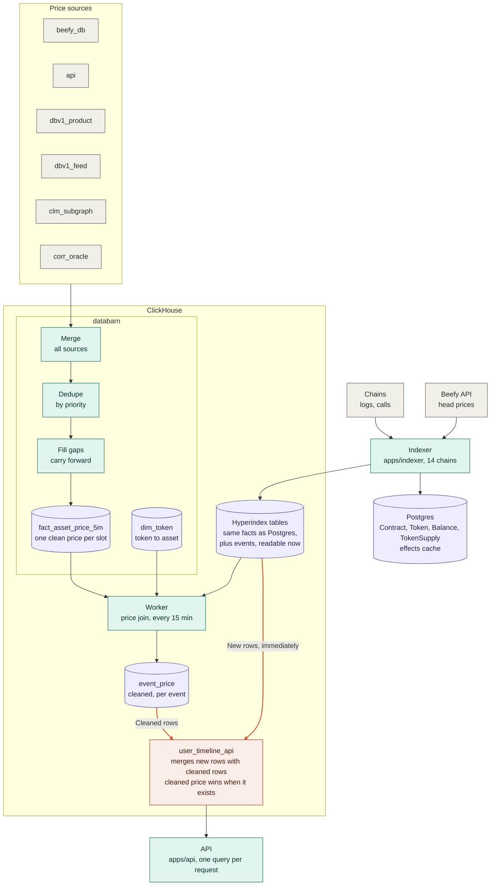

# Beefy balances

A pnpm + Turborepo monorepo for tracking Beefy user positions and PnL: a raw-events indexer, an account-first ClickHouse
analytics schema (`packages/clickhouse`), a worker for background jobs, and an API. Raw facts come from the
chains, prices from the databarn ClickHouse, and everything derived (positions, PnL) is computed downstream, so changing
a formula never forces a reindex.

```
apps/
  indexer/          @beefy/indexer          Envio HyperIndex 3.14 indexer (events → ClickHouse, state → Postgres)
  worker/           @beefy/worker           Background jobs: a small scheduler plus jobs
  api/              @beefy/api              Read API over ClickHouse: Hono + zod-openapi. GET /v1/users/{address}/timeline
                                            (cached, rate limited, single-flight), /healthz, /openapi.json
  rpc-cache-proxy/  @beefy/rpc-cache-proxy  Local JSON-RPC proxy that records logs, blocks, transactions and eth_calls in
                                            Postgres and replays them, so a reindex does not refetch (dev and test tool)
packages/
  models/           @beefy/models           Dependency-free domain models: chain registry, hex helpers
  config/           @beefy/config           Typed fail-fast env parsing, ClickHouse connection settings
  clickhouse/       @beefy/clickhouse       Timeline read path over Envio's TimelineEvent, pricing, watermark, versions
                                            (deploy, switch, cleanup) and synthetic-data commands (integration tests need a ClickHouse)
  tsconfig/         @beefy/tsconfig         Shared TypeScript settings (base, app, library)
docs/               Architecture and Envio reference notes
```

Start with [docs/architecture.md](docs/architecture.md) (what is indexed, the timeline and its prices, versions, the public
API and its caching) and the [indexer README](apps/indexer/README.md).

## Architecture



Gray is an external source, purple a table, teal a process and coral the read-time merge.

- **New rows are readable at once.** The indexer writes events to the Hyperindex tables in ClickHouse, with the head price
  of the Beefy API as a provisional price. `user_timeline_api` reads them directly.
- **Cleaned rows come later.** databarn merges its price sources, keeps one price per asset and 5 minute slot, and carries
  values forward over gaps. The worker joins events with those prices into `event_price` every 15 minutes.
- **One merge, at read time.** `user_timeline_api` takes the stored price when it exists, else the head price, else
  `PENDING`. See [docs/architecture.md](docs/architecture.md#read-path).

## Getting started

Requirements: Node 26.13.0 (`.nvmrc`; `nvm use` / `fnm use`) and pnpm 11.28.6 (pinned in `packageManager` and `engines`;
`corepack enable` picks it up).

```bash
pnpm install        # whole workspace, from the repo root
pnpm build          # packages compile to dist/ (apps import them from there)
pnpm infra:start    # local Postgres (127.0.0.1:55433) and ClickHouse (127.0.0.1:18123); needs Docker
pnpm test           # formatting check, typecheck and unit tests of everything
```

Each app has a `.env.example`; copy it to `.env` in that app's directory. Never commit a `.env`.

## Commands

All run from the repo root. 
| Command | What it does |
|---|---|
| `pnpm build` | Build the packages |
| `pnpm test` | Everything the CI gate checks: `test:ts`, `test:unit`, `test:lint` and `test:secretlint` |
| `pnpm test:ts` | `tsc --noEmit` in every package (builds the packages and runs the indexer's codegen first) |
| `pnpm test:unit` | Vitest in every package |
| `pnpm test:lint` | oxlint (type-aware) in every package |
| `pnpm test:secretlint` | secretlint over every git-tracked file |
| `pnpm format` | oxfmt over the whole repo: the only format command |
| `pnpm infra:start` / `infra:stop` / `infra:reset` | Local Postgres + ClickHouse (`docker-compose.yml`); `reset` also deletes their data |
| `pnpm codegen` | Envio codegen for the indexer |
| `pnpm clean` | Remove build output and the Turborepo cache |
| `pnpm --filter @beefy/<app> <script>` | Any other script of one app (`dev`, `start`, `correctness`, ...) |

Every package defines the same `build`, `test`, `test:ts`, `test:unit` and `test:lint` scripts, so inside
a package `pnpm test` and friends work on that package alone; the root ones fan out through Turborepo, in dependency
order and cached on their inputs (a second `pnpm test` with no changes is instant).

To work on one app, `cd` into it and use its own scripts (`pnpm dev`, `pnpm test`).

## Conventions

- **Versions are exact and locked.** Dependencies have no `^` or `~` (`savePrefix: ""`), and `pnpm-lock.yaml` is
  committed; install in CI with `pnpm install --frozen-lockfile`. Versions used by several packages live once in the
  `catalog:` of `pnpm-workspace.yaml` (`catalogMode: strict` rejects a different version in a package).
- **Supply chain.** New releases are not installable for a week (`minimumReleaseAge`), a package may not lose its
  trusted-publisher provenance (`trustPolicy: no-downgrade`), exotic (git / tarball) transitive dependencies are blocked,
  and install scripts only run for packages listed in `allowBuilds`.
- **Tooling.** oxlint (type-aware, `.oxlintrc.json`: correctness rules as errors, warnings denied) lints, oxfmt
  (`.oxfmtrc.json`, still 0.x) formats, `pnpm format` is the only format command and the pre-commit hook runs it on
  staged files. A `typescript/no-unnecessary-type-assertion` autofix can remove a cast `tsc` needs: `test:ts` catches
  it, then restore the cast with a justified `oxlint-disable-next-line`.
- **Secrets.** secretlint (recommended preset, `.secretlintrc.json`) scans every tracked file in `test:secretlint` and
  every staged file before a commit. Never put a credential-shaped value in an `.env.example` (it fails the scan);
  `.env` files are gitignored. The docker-compose defaults (`testing` password, loopback-only ports) are for local use.
- **Engines are enforced** (`engineStrict`): Node and pnpm versions come from `package.json` and `.nvmrc`.
- **Turborepo runs in strict env mode.** A task only sees the variables declared in `turbo.json`; add a new one to
  `passThroughEnv` (not hashed) or `env` (hashed, changes the cache key) on purpose. Telemetry: set
  `TURBO_TELEMETRY_DISABLED=1` (or run `pnpm exec turbo telemetry disable` once).
- **Internal packages are compiled.** `packages/*` build to `dist/` with `tsc` (ESM, `.ts` extensions in source are
  rewritten to `.js`) and export only `dist`, so an app can run on plain Node, also when deployed.
- **Fail fast configuration.** Apps read their environment through `@beefy/config`, which reports every problem at once,
  has safe defaults, and refuses a ClickHouse analytics database that equals the indexer's (Envio drops its own on a
  reindex).
- **The indexer is self-contained on purpose.** Envio Cloud deploys from a root directory and warns that imports from
  outside it can break the deployment, so `apps/indexer` depends on no workspace package and extends no shared
  tsconfig. `packages/models` has a test that keeps its chain list equal to the indexer's `config.yaml`.

## Adding an app or a package

1. Create `apps/<name>` or `packages/<name>` with a `package.json` named `@beefy/<name>` (`private: true`,
   `type: module`, `engines`), a `tsconfig.json` extending `@beefy/tsconfig/app.json` (or `library.json` for a package
   with an `outDir`/`rootDir`), and the standard scripts (`test`, `test:ts`, `test:unit`, `test:lint`). Packages also need a `build` script and an `exports`
   map pointing at `dist`.
2. Use `catalog:` for versions that exist in the catalog, exact versions otherwise.
3. `pnpm install`, then `pnpm test`.

## Deployment notes

- **Indexer (Envio Cloud).** Point the indexer at the root directory `apps/indexer` (config file `config.yaml`).
  Not verified yet: a deploy from this layout, and which pnpm / Envio versions the cloud accepts.
- **Worker and API (Heroku).** Not set up yet. The API reads `PORT`; both shut down on `SIGTERM`. `WORKER_JOBS` picks
  which jobs a process runs, so each job can be its own process type. A monorepo build must run `pnpm build` for the
  packages before starting an app.
- **API caching.** The API sets `Cache-Control` and `ETag` for browsers and Cloudflare and keeps its own in-process cache:
  see [docs/architecture.md](docs/architecture.md#public-api-and-caching).
